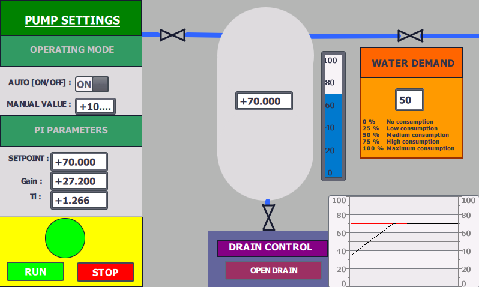
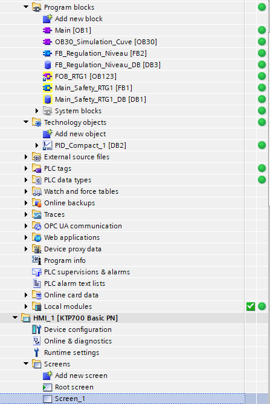

# Siemens TIA Portal – Tank Level Control

**Industrial Automation | PLC Programming | HMI Development | PI Process Control**

## 1. Project Overview

This personal project focuses on the development of a simulated industrial tank level control system using Siemens TIA Portal V20.

The objective is to develop practical skills in industrial automation, PLC programming, process control and HMI development.

The project simulates an industrial process involving a water tank, a variable-speed pump, an adjustable water consumer and a drain valve.

## 2. Technologies Used

- **PLC:** Siemens S7-1500
- **Engineering Software:** TIA Portal V20
- **PLC Simulation:** S7-PLCSIM
- **HMI:** WinCC
- **Programming Language:** LAD (Ladder Logic)
- **Process Control:** PID_Compact (PI Controller)

## 3. System Description

The simulated installation consists of:

- A water tank with continuous level monitoring.
- A variable-speed pump controlling the inlet flow.
- An adjustable water consumer simulating process demand.
- A drain valve for tank emptying.
- A PI controller regulating the tank level.

The process simulation calculates the evolution of the tank level based on the inlet flow, water consumption and drainage.

## 4. Main Functionalities

### PLC Programming
- Development of the process control logic.
- Manual and automatic operating modes.
- Pump start/stop management.
- Tank filling and draining sequences.
- Process variable calculations.

### Process Control
- Integration of the Siemens PID_Compact technology object.
- PI controller configuration and tuning.
- Setpoint management.
- Automatic pump speed adjustment based on tank level.
- Monitoring of the control loop response.

### HMI Development
- Process visualization through a WinCC interface.
- Manual/automatic mode selection.
- Pump speed control.
- Water demand adjustment.
- Drain valve control.
- Setpoint and PI parameter access.
- Real-time trend visualization.

## 5. Screenshots

### HMI – Process Overview

### PLC – Program Structure

## 6. Project Files

The complete TIA Portal V20 project archive is available in this repository:

`Tank_Level_Control_TIA_V20.zap20`

The project can be opened using Siemens TIA Portal V20.

## 7. Project Scope and Limitations

This is a personal project developed and tested in a simulated environment.

It is intended to demonstrate practical knowledge of PLC programming, process control and industrial supervision.

The PI controller tuning and process response are still being evaluated and improved. The project does not represent a commissioned industrial installation.

## 8. Project Status

**Work in Progress**

Further improvements include PI controller optimization, additional testing scenarios and HMI enhancements.

---

**Developed as a personal learning project in industrial automation.**
